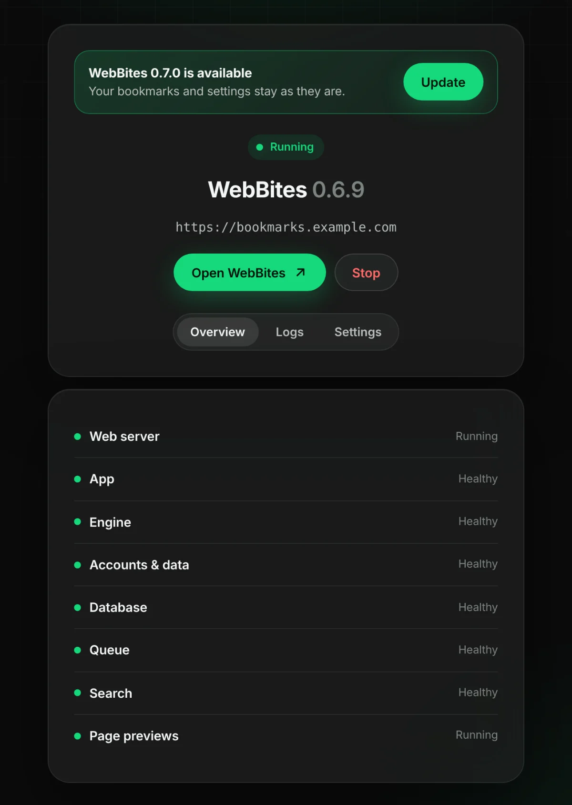
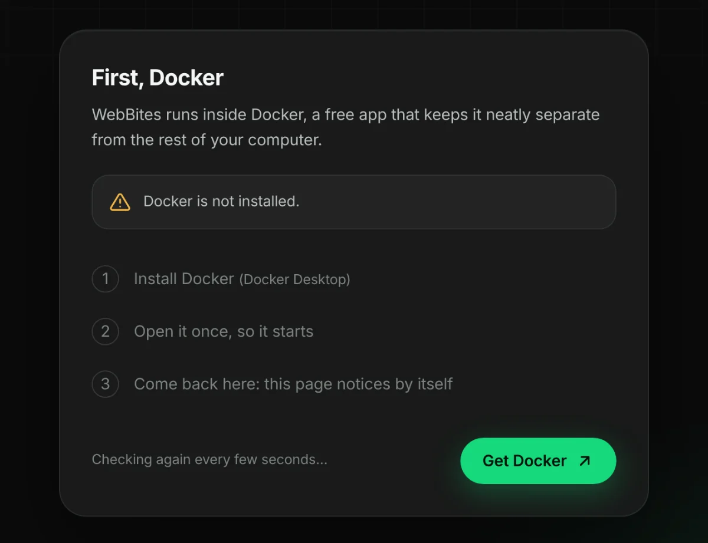
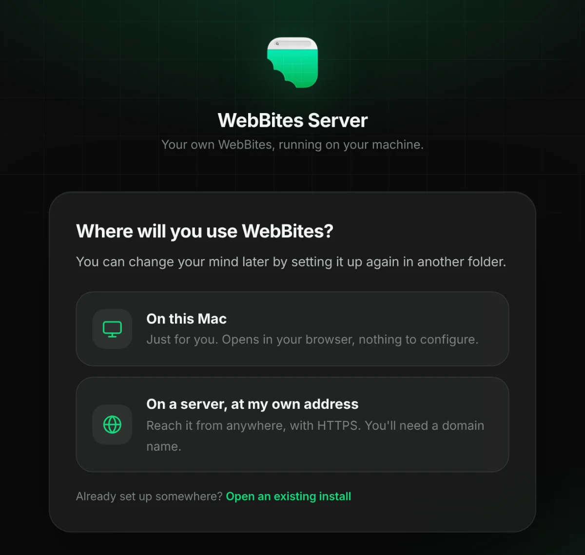
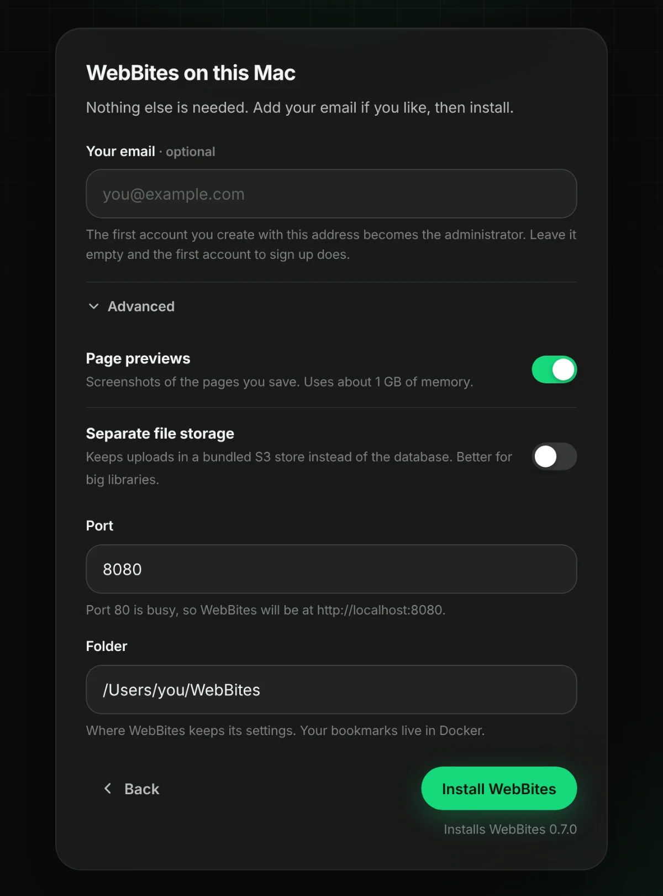
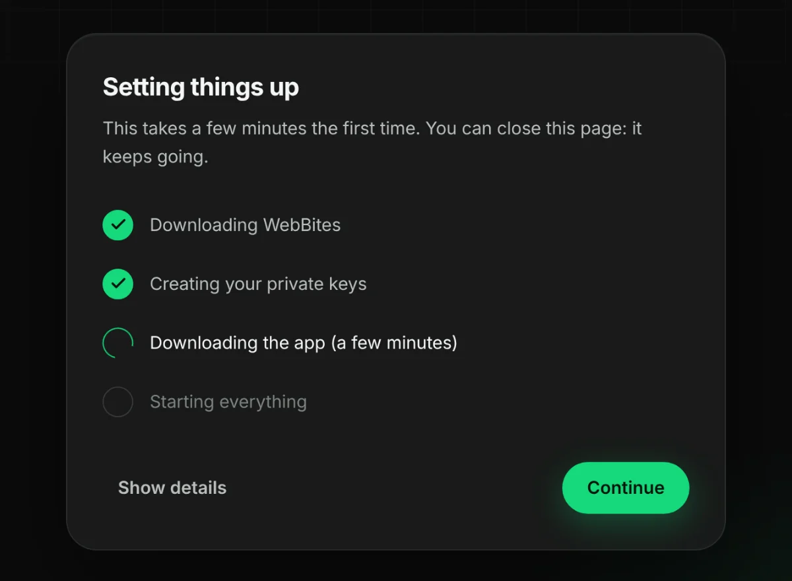
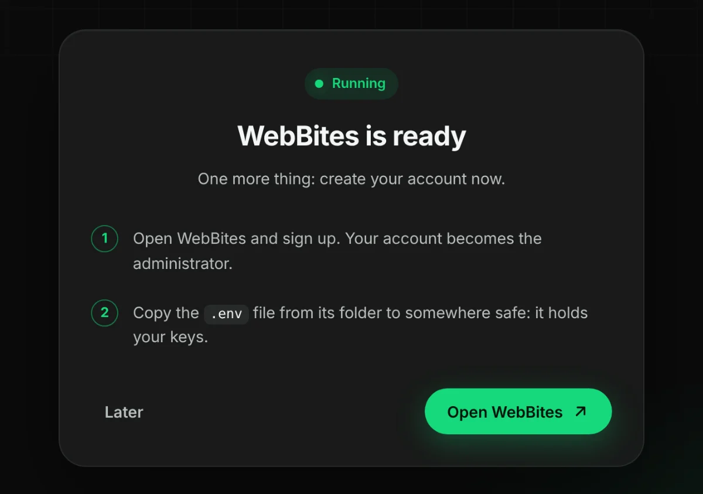
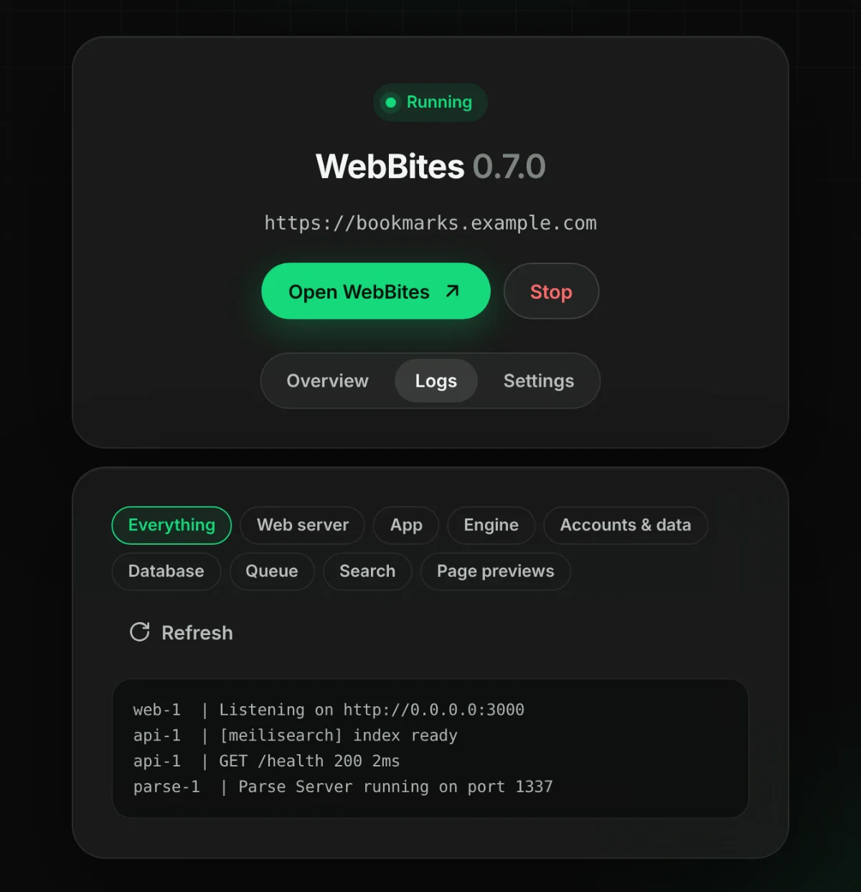
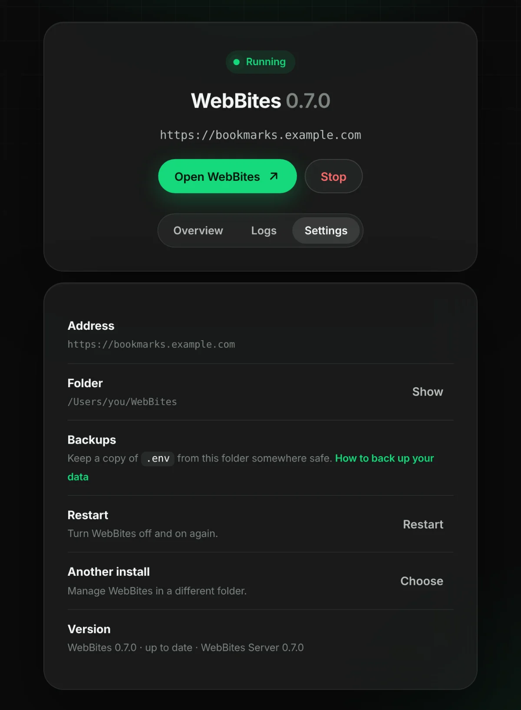

# WebBites Server (the desktop app)

A small app for macOS, Windows and Linux that sets WebBites up with Docker and then runs it for you,
without a terminal. It lives in the menu bar (the notification area on Windows and Linux), and the same
file is a command-line tool for servers. It does what `deploy/get.sh` and `deploy/install.sh` do.

Also on the web, with the same pictures: [webbites.io/developers/docs/self-hosting-app](https://www.webbites.io/developers/docs/self-hosting-app).

<p align="center"></p>

## Download

From the [latest release](https://github.com/elrumo/webbites_public/releases/latest):

| Computer | File | Then |
|---|---|---|
| **macOS** 11+, Apple silicon and Intel | [`WebBites-Server-macOS.zip`](https://github.com/elrumo/webbites_public/releases/latest/download/WebBites-Server-macOS.zip) | Unzip it and move **WebBites Server** to Applications. |
| **Windows** 10 or 11, x64 or Arm | [`…-windows-amd64.zip`](https://github.com/elrumo/webbites_public/releases/latest/download/WebBites-Server-windows-amd64.zip), [`…-windows-arm64.zip`](https://github.com/elrumo/webbites_public/releases/latest/download/WebBites-Server-windows-arm64.zip) | Unzip it and run **WebBites Server.exe**. |
| **Linux** x64 or Arm | [`…-linux-amd64.tar.gz`](https://github.com/elrumo/webbites_public/releases/latest/download/WebBites-Server-linux-amd64.tar.gz), [`…-linux-arm64.tar.gz`](https://github.com/elrumo/webbites_public/releases/latest/download/WebBites-Server-linux-arm64.tar.gz) | Unpack it and run `webbites-server`. For a launcher, copy `webbites-server.desktop` to `~/.local/share/applications/`, and the binary and icon somewhere on your `PATH` and icon path. |

You also need [Docker Desktop](https://www.docker.com/products/docker-desktop/) (or Docker Engine with
the Compose plugin on Linux), and 2 GB of free memory (3 GB with page previews).

The first time, your computer may ask whether you trust an app from the internet. The Mac app is signed and
notarized by Apple, so on a Mac you only confirm **Open** once. On Windows, if SmartScreen appears, choose
**More info → Run anyway**.

## Set it up

Open the app. The first time, it opens its setup page in your browser.

| | |
|---|---|
|  | **1. Docker.** If it's missing or not running, the page says which and links to it. Install it, open it once, and come back: the page notices by itself. |
|  | **2. Where.** **On this Mac/PC**: at `http://localhost`, nothing to configure. **On a server, at my own address**: your domain, with HTTPS. Or **open an existing install** in another folder. |
|  | **3. Details.** Your email (optional: only that address can become the administrator) and, for a server, your domain. **Advanced** holds page previews (about 1 GB of RAM), separate S3 file storage, the port (prefilled with a free one) and the folder (`~/WebBites`). |
|  | **4. Install.** Four named steps; a few minutes the first time. You can close the page: it keeps going. If a step fails, it says why in plain words, with **Try again** and the full log under **Show details**. |
|  | **5. Ready.** Open WebBites and **create your account straight away**: the first one becomes the administrator. Copy `.env` from the folder somewhere safe. |

## Every day

The setup page (**Settings and logs…** in the menu) shows whether WebBites is running, its version and
address, **Open WebBites** and **Start/Stop**, and a banner when an update is out. Three tabs:

- **Overview**: each part under a plain name (Web server = `caddy`, App = `web`, Engine = `api`, Accounts & data = `parse`, Database = `mongo`, Queue = `redis`, Search = `meilisearch`, Page previews = `screenshot`, File storage = `rustfs`) and its state.
- **Logs**: the latest lines, from everything or one part.
- **Settings**: address, folder, backups, Restart, Another install, versions.

| Logs | Settings |
|---|---|
|  |  |

The menu-bar icon has the state (**Running · 0.7.0**), **Open WebBites**, **Start**, **Stop**, **Update
to x.y.z…** when a release is out, **Settings and logs…**, **Show folder** and **Quit**. Quitting the app
leaves WebBites running: it lives in Docker, not in the app.

**Updating** downloads the new release's files (the old ones go to `.previous/`), pulls the new images
and restarts WebBites. Bookmarks, settings and `.env` stay as they are. Back up first: see [backups](backups.md).

**Removing**: stop it, run `docker compose down -v` in its folder (this deletes the data), delete the
folder and the app.

## On a server (no desktop)

The same binary is a command-line tool:

```sh
curl -fsSL https://github.com/elrumo/webbites_public/releases/latest/download/WebBites-Server-linux-amd64.tar.gz | tar xz
sudo install WebBites-Server-linux-amd64/webbites-server /usr/local/bin/

webbites-server install            # asks the same questions (or --domain ... --email ... --yes)
webbites-server status             # running? which version, which address
webbites-server update             # to the latest release (--version x.y.z for another)
webbites-server start | stop | restart
webbites-server logs api -f
webbites-server ui                 # the setup page; reach it through an SSH tunnel
```

Every command takes `--dir <folder>`. Without a desktop, `webbites-server` with no command starts the
setup page and prints its address.

## Safety

The setup page listens on `127.0.0.1` only, on a random port, and answers only with the random key in
the address the app opens. Other websites in your browser can't reach it, and an old or copied link shows
"Open WebBites Server from its menu" instead. It runs `docker compose` in the WebBites folder and nothing
else.

## Updating the screenshots

The pictures here and on webbites.io are in `apps/web/public/self-hosting/app/`. They come from the real
setup page with its API faked, so every state can be shown without Docker:

```sh
cd apps/installer
go run . ui                                    # prints the setup page's address
node packaging/screenshots.cjs '<that address>' ../web/public/self-hosting/app
```

It needs Playwright. If a picture's height changes, copy the sizes it prints into `SIZES` in
`apps/web/app/components/developers/DevSectionSelfHostingApp.vue`.
