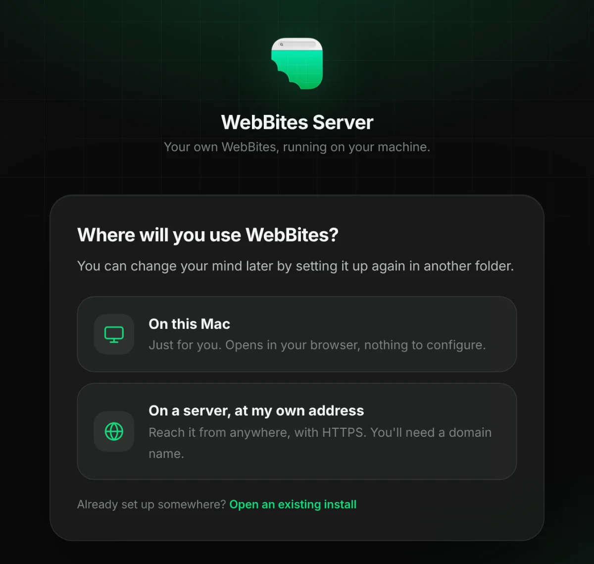

# Quickstart

You need a machine with Docker (Compose v2), 2 GB of RAM (3 GB with screenshots), and for a public
install a domain name pointing at it with ports 80 and 443 open. Three ways in; they all end in the
same setup (a folder with `docker-compose.yml`, `Caddyfile` and an `.env` of fresh secrets).

## On a server: one command

```sh
curl -fsSL https://raw.githubusercontent.com/elrumo/webbites_public/master/deploy/get.sh | sh
```

It downloads only the deployment files of the latest release into `./webbites` (no clone), asks a few
questions, writes `.env`, pulls the images and starts WebBites. Give the answers up front to skip the
questions:

```sh
curl -fsSL https://raw.githubusercontent.com/elrumo/webbites_public/master/deploy/get.sh \
  | sh -s -- --domain notes.example.com --email you@example.com
```

Options: `--dir <folder>`, `--version x.y.z`, `--no-start`, and the installer's own (`--domain`,
`--email`, `--http-port`, `--rustfs`, `--no-screenshots`, `--yes`). Run the same command again in the
same place to upgrade.

## On your Mac or PC: the WebBites Server app

Download **WebBites Server** for macOS, Windows or Linux from the
[latest release](https://github.com/elrumo/webbites_public/releases/latest) and open it. It sits in the
menu bar (notification area on Windows and Linux), checks Docker, sets WebBites up from a page in your
browser, and then starts, stops and updates it. See [the app](desktop-app.md).

<p align="center"></p>

## From a clone

```sh
git clone https://github.com/elrumo/webbites_public.git
cd webbites_public/deploy
./install.sh
docker compose pull
docker compose up -d
```

`install.sh` asks for a domain (use `localhost` to try it on one machine), an email address, and whether
to keep files in a bundled S3 store and run the screenshot service. It writes `.env` with freshly
generated secrets and never overwrites an existing one. Non-interactively:

```sh
./install.sh --domain notes.example.com --email you@example.com --yes
```

## Then

Open the address it prints and **create your account straight away: the first account becomes the
administrator.** If you gave an email, only that address can claim it, so a stranger who finds the
server first cannot. (Leave the email empty and whoever signs up first wins. Do not leave a fresh
install unattended on the internet.)

Then, as administrator, open **/admin → Settings** to connect email, an AI endpoint, and so on.

## What runs

| Container | Role |
|---|---|
| `caddy` | The only thing that listens on ports 80/443. Gets the HTTPS certificate. |
| `web` | The app |
| `api` | The backend: bookmarks, search, jobs, the public API and MCP server |
| `parse` | Parse Server: accounts, data, live updates, file serving |
| `mongo` | Database (and file storage unless you choose S3) |
| `redis` | Job queue, rate limits, developer API keys. Persisted: it is not just a cache |
| `meilisearch` | Search |
| `screenshot` | Optional: the headless browser that screenshots pages (profile `screenshots`) |
| `rustfs` | Optional: S3-compatible file store (profile `rustfs`) |

## Trying it on one machine

`./install.sh --domain localhost --yes` serves plain http://localhost (`--http-port 8080` if port 80 is
taken: http://localhost:8080). Fine for a look around. For a
home server reached by IP or a `.local` name, use a real hostname with HTTPS if you can: browsers refuse
secure cookies on plain http (the app switches them off for non-localhost http installs, so sign-in works,
but the session then travels unencrypted).

## Something wrong?

```sh
docker compose ps
docker compose logs --tail 100 parse api web
```
